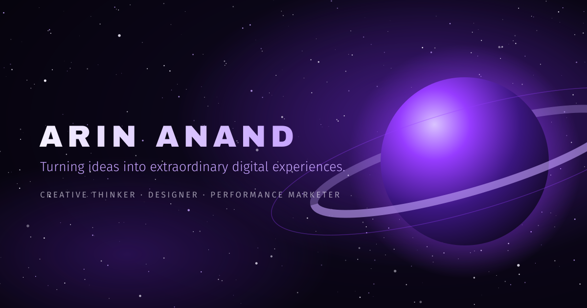

# Arin Anand - Interactive Cosmic Portfolio

The personal portfolio of **Arin Anand**: creative thinker, designer and performance marketer.

It is built as one continuous journey through a midnight-purple universe: a living star field that reacts to the
cursor, a ringed WebGL planet in the hero, a spiral galaxy, a pinned orbital process timeline, an interactive
experiments lab and a planet rising behind the contact form.



---

## Contents

- [Features](#features)
- [Tech stack](#tech-stack)
- [Getting started](#getting-started)
- [Editing content](#editing-content)
- [Deploying to GitHub Pages](#deploying-to-github-pages)
- [Project structure](#project-structure)
- [Performance and accessibility](#performance-and-accessibility)
- [Browser support](#browser-support)

## Features

| Area | What it does |
| --- | --- |
| **Intro** | The name appears letter by letter while fonts load, then a ring of light opens onto the hero. Shorter on repeat visits; skipped with reduced motion. |
| **Hero** | Shader-rendered gas giant with banded clouds, atmosphere, rings (with the planet's shadow on the rings and the rings' shadow on the planet), orbit paths and three moons. Flowing light ribbons, parallax, letter-by-letter headline with an animated gradient. |
| **Star field** | Up to ~1,100 stars on a canvas. Fast cursor movement scatters them; slow movement pulls them into a gentle gravitational swirl with faint threads; springs bring every star home. Clicks and taps send out ripples. A painted Milky Way, drifting nebulae and occasional meteors sit behind. |
| **Cursor** | Glowing dot and trailing ring, purple light that follows the pointer, a sparkle trail, labels over project cards ("View") and magnetic buttons. Native cursor returns over text fields. Mouse/trackpad only. |
| **About** | Statement whose words light up as you scroll, a large portrait of Arin over an interactive spiral galaxy (parallax, tilt and a reveal wipe), four pillars, and a roles marquee. |
| **Skills & Services** | Sixteen cards, from logo design to software development, each with its own animated illustration. Clicking a card opens that skill's **work gallery** (images and videos, full-screen image viewer, previous/next skill). Each skill has a shareable link: `#skill-<id>`. |
| **How I work** | Six stages on a glowing orbital path. On desktop the section pins and travels sideways as you scroll; on smaller screens it becomes a vertical timeline. |
| **Clients** | A count-up number of companies worked with and a scrolling wall of their logos. |
| **Experiments** | A playground with four interactive pieces - gravity well, constellations, nebula brush and warp drive - plus a list of experimental work. |
| **Blog** | Article list linking to wherever you publish. |
| **Contact** | Validated form (inline errors, focus management, loading and error states), email, social links, galaxy swirl and a planet that rises as you reach the end. |
| **Footer** | Giant wordmark, a second photo with the line "Brands, websites, campaigns and experiments", navigation, contact links, dynamic copyright year, back-to-top button that doubles as a scroll-progress ring, and a **Reduce motion** switch. |

## Tech stack

- **React 19 + TypeScript**, bundled with **Vite 5**.
- **Custom WebGL** for the planet - a single fragment shader, no 3D library.
- **Canvas 2D** for the star field, galaxy and experiments lab.
- **A small built-in motion system** (`src/lib`): one shared animation loop, inertial wheel scrolling,
  scroll-linked progress (a lightweight equivalent of a scrubbed ScrollTrigger) and IntersectionObserver reveals.
- **Modern CSS** with design tokens in `src/styles/tokens.css`.

The only runtime dependencies are `react` and `react-dom` (about 300 KB of JavaScript before gzip, including React).
Three.js and GSAP were the brief's preferred tools. The custom versions do the same jobs with far less code to
download. If you would rather move to Three.js / GSAP later, the planet (`components/Hero/planetRenderer.ts`) and the
motion helpers (`src/lib`) are self-contained and can be swapped one at a time.

## Getting started

Requires **Node.js 20 or newer**.

```bash
npm install
npm run dev        # http://localhost:5173
```

Other scripts:

```bash
npm run build      # production build into dist/
npm run preview    # serve the production build locally
npm run typecheck  # TypeScript check
npm run check      # typecheck + build
```

To preview the GitHub Pages path locally (replace with your repository name):

```bash
BASE_PATH=/your-repo-name/ npm run build && npm run preview
```

## Editing content

Everything you are likely to change lives in **`src/data/`**. You never need to touch the components.

| File | What it controls |
| --- | --- |
| `site.ts` | Name, short bio, **email**, **phone**, **form endpoint**, location, availability line, navigation, footer photo and tagline. |
| `about.ts` | About statement, intro, pillars, roles and the **portrait photo**. |
| `social.ts` | LinkedIn, Instagram, Behance and any other profiles. Add the profile URL to `href` to make it clickable; `handle` is the name shown. Entries with neither are hidden. |
| `services.ts` | The sixteen skills **and the work samples** shown when each one is opened. |
| `clients.ts` | **Company logos** and the companies-worked-with number. |
| `process.ts` | The six "How I work" stages. |
| `experiments.ts` | Experiments list (and the names/hints of the four interactive pieces). |
| `blog.ts` | Blog entries - link each to the article URL. |

> **Placeholders:** blog posts and experiments are placeholders, marked "Placeholder" / "In the works" on the
> site. Skills without samples show a "Work samples are on their way" message, and the clients section shows empty
> logo slots until you add logos. Nothing has been invented: no client names, numbers or results.

### Adding work samples to a skill

1. Put the files in `public/work/<skill id>/`, e.g. `public/work/logo-brand-identity/cafe-logo.webp`.
   Images: WebP or JPG, about 1600 px on the long side, under ~400 KB. Videos: MP4 with a poster image.
2. List them in that skill's `samples` array in `src/data/services.ts`:

```ts
samples: [
  { type: 'image', src: 'work/logo-brand-identity/cafe-logo.webp', alt: 'Cafe logo on a cup', title: 'Cafe logo' },
  { type: 'video', src: 'work/video/brand-reel.mp4', poster: 'work/video/brand-reel.webp', alt: 'Brand reel', title: 'Brand reel' },
],
```

The card then shows "View N samples", and the gallery opens at `#skill-<id>`.

### Adding company logos

Put logo files in `public/clients/` (SVG or transparent PNG/WebP) and list them in `src/data/clients.ts`.
Logos appear as even white silhouettes and turn full colour on hover. Set `companiesCount` (e.g. `25` for "25+")
or leave it at `0` to count the logos automatically. A company without a logo file can be listed by name only.

### Connecting the contact form

In `src/data/site.ts`:

- **`email`** - your public address. Shown on the site; with no endpoint set, the form opens the visitor's email app
  with their message ready to send.
- **`formEndpoint`** - optional. Any service that accepts a JSON `POST` (Formspree, Getform, Basin, your own API).
  With an endpoint the form sends in place and shows sent / error states.

Until one of these is set, the form validates normally and then tells the visitor it isn't connected yet.

### Colours, type and spacing

Design tokens are in `src/styles/tokens.css` - the full midnight-purple palette, type scale, spacing, radii and
easing curves. Headings use **Alice** and body text uses **Lora**, both from Google Fonts, loaded in `index.html`.

## Deploying to GitHub Pages

A workflow is included at `.github/workflows/deploy.yml`.

1. Push the project to GitHub and merge it into `main`.
2. In the repository go to **Settings → Pages** and set **Source** to **GitHub Actions**.
3. Every push to `main` (or a manual run from the **Actions** tab) builds and deploys the site.

The workflow works out the base path automatically:

| Repository | Site URL | Base path |
| --- | --- | --- |
| `username.github.io` | `https://username.github.io/` | `/` |
| any other name, e.g. `portfolio` | `https://username.github.io/portfolio/` | `/portfolio/` |
| any repo with `public/CNAME` | `https://your-domain/` | `/` |

For a **custom domain**, add a file `public/CNAME` containing just the domain (e.g. `arinanand.com`) and set up DNS
as described in GitHub's Pages documentation.

The workflow also sets `SITE_URL`, which fills in the canonical link and absolute social-sharing image URLs in
`index.html`. All in-page links use `#section` anchors, so there are no server routes to configure.

## Project structure

```
src/
  components/
    Navbar/            header, sliding active indicator, mobile menu
    Loader/            intro sequence
    Hero/              hero layout, PlanetCanvas, planetRenderer (WebGL shader), Ribbons
    CosmicBackground/  nebulae, cursor light, layer parallax
    StarField/         interactive star physics + Milky Way (starfieldEngine.ts)
    InteractiveCursor/ custom cursor
    About/             statement, galaxy (galaxyEngine.ts), pillars, roles marquee
    Services/          skill cards, ServiceVisual illustrations, SkillDialog (work gallery + image viewer)
    Clients/           companies count + logo wall
    Process/           pinned orbital timeline
    Experiments/       playground (playgroundEngine.ts) + experiments list
    Blog/
    Contact/           ContactForm with validation
    Footer/
    shared/            Button (magnetic), SplitText, Icon, ErrorBoundary
  data/                ← edit content here
  hooks/               reveals, scroll progress, in-view, magnetic, tilt, active section
  lib/                 ticker, smooth scroll, scroll progress, pointer, device profile, motion preference
  styles/              tokens.css, global.css
public/
  about/               About section photos
  work/                work samples, one folder per skill (see work/README.txt)
  clients/             company logos (create when you add the first one)
  favicon.svg, apple-touch-icon.png, og-image.png, site.webmanifest, robots.txt
```

## Performance and accessibility

- **One animation loop** drives every effect; it stops completely when the tab is hidden.
- Canvases and the planet **only render while on screen**; the planet doesn't render at all until its entrance.
- Star counts, galaxy size, experiment particles and pixel ratio scale with the device (cores, memory, screen size,
  touch). Pixel ratio is capped (≤ 1.75; the planet ≤ 1.5).
- **No WebGL?** The hero shows a CSS planet instead. A lost GPU context also falls back gracefully, and an error
  boundary keeps any one visual from breaking the page.
- Project images are **lazy-loaded** with a shimmer placeholder and a clear message if a path is wrong.
- **Reduced motion**: respects `prefers-reduced-motion`, and visitors can switch it on or off from the footer.
  Everything becomes static and fully visible.
- **Keyboard**: skip link, visible focus everywhere, focus moves to the section you jump to, the mobile menu and
  skill gallery and image viewer trap focus and close with Escape, and the experiments lab responds to Space/Enter.
- **Screen readers**: split headlines expose the plain sentence; decorative layers are hidden; form errors are linked
  to their fields and announced.
- Touch devices get native scrolling, tap ripples and touch-reactive stars instead of the cursor effects.

## Browser support

Current Chrome, Edge, Safari (16.4+) and Firefox, on desktop and mobile.
